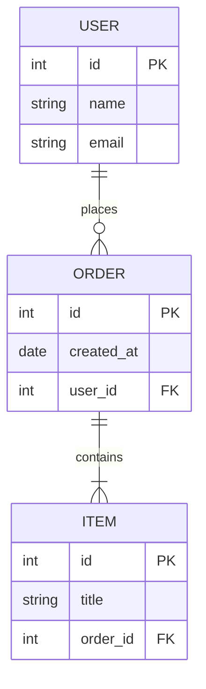

# SQL Server in Docker (shared by all .NET projects)

SQL Server 2022 in Docker for .NET development on macOS, including Apple Silicon.
One `docker compose up -d` starts the server and builds the `section_b` database from `scripts/01_section_b.sql`.
After that, every time you save that file, the database is rebuilt from it automatically.

## Architecture / How it Works




Pairs with [EFBoilerplate](https://github.com/ALPHAMAN-0/EFBoilerplate), a `dotnet new` template for ASP.NET Core MVC + EF Core that's already connected to this database.

| Setting  | Value                                  |
|----------|----------------------------------------|
| Server   | `localhost`, port `1433`               |
| User     | `sa`                                   |
| Password | the one you set in `.env` (see Setup)  |

Port 1433 is open on all of the Mac's network addresses, so a Windows VM in UTM can connect too (see [Windows VM in UTM](#windows-vm-in-utm)).
Other devices on the same Wi-Fi can reach the port as well, so keep a strong SA password.

## Setup

You need [Docker Desktop](https://www.docker.com/products/docker-desktop/).
On Apple Silicon, turn on **Settings → General → Use Rosetta for x86_64/amd64 emulation**, because SQL Server has no ARM image.

It works the same on macOS, Windows and Linux:

- **Windows:** Docker Desktop with the WSL 2 backend. Commands work in PowerShell as written.
- **Linux:** Docker Engine with the `docker compose` plugin, or Docker Desktop.
  Docker skips `ufw`, so port 1433 is open to your network even if the firewall is on.
- **ARM PCs** (Windows on Snapdragon, Raspberry Pi) aren't supported. SQL Server only runs on Intel/AMD, and only Macs have Rosetta to translate it.

```sh
git clone https://github.com/ALPHAMAN-0/docker-sqlserver.git
cd docker-sqlserver
cp .env.example .env          # then open .env and choose your own SA password
docker compose up -d
```

`.env` is gitignored, so your password never gets committed.

## Start / stop

```sh
docker compose up -d                       # start the server and the scripts/ watcher
docker compose logs -f sqlserver-watch     # follow every rebuild live
docker compose stop                        # stop (data is kept)
```

Both containers also start by themselves whenever Docker Desktop starts.
Your databases are stored in the `mssql-data` volume, so they survive container rebuilds. Only `docker volume rm mssql-data` deletes them.

## Save the SQL file, the database is rebuilt

The `sqlserver-watch` container checks `scripts/` every second. When you save `scripts/01_section_b.sql`, it:

1. deletes the `section_b` database (anyone connected to it, like SSMS or a running app, is disconnected),
2. creates it again, empty,
3. runs the whole file inside it, from the first `CREATE TABLE` to the last query,
4. writes everything sqlcmd printed (rows from your `SELECT`s, errors, `=== OK` or `=== FAILED`) to `scripts-run.log`.

So write plain SQL with no `IF NOT EXISTS` checks, and leave out `CREATE DATABASE` and `USE`.
Use `GO` before statements that must start a batch, like `CREATE VIEW` or `CREATE PROCEDURE`.
If the run stops at an error, fix the line `scripts-run.log` points to and save again.

**Every save erases data your apps added to `section_b`.** Put rows you want to keep as `INSERT`s in the file.
Restarting Docker or the Mac doesn't rebuild anything unless the file changed while the watcher was off.
The logic is in `sql-watch.sh`, and the database name is `DB_NAME` in `docker-compose.yml`.

`scripts/01_section_b.sql` currently creates these tables:

| Table       | Columns                                       | Sample rows |
|-------------|-----------------------------------------------|-------------|
| `products`  | id, name, description, price, stock, category | 3 |
| `students`  | id, name, dept, cgpa                          | 3 |
| `employees` | id, email, name, designation, age, salary     | 5 |

**To add your own table**, add it to the file and save:

```sql
CREATE TABLE dbo.courses (
    id    INT IDENTITY(1,1) PRIMARY KEY,
    title NVARCHAR(MAX) NOT NULL
);
INSERT INTO dbo.courses (title) VALUES ('C#'), ('Databases');
SELECT * FROM dbo.courses;   -- result shows up in scripts-run.log
```

## Start a new project: `dotnet new efmvc`

See [EFBoilerplate](https://github.com/ALPHAMAN-0/EFBoilerplate). It's a template that creates a ready-to-run MVC + EF Core project wired to this database:

```sh
dotnet new efmvc -n Lab5
cd Lab5/Lab5
dotnet run                            # open http://localhost:5173/product
```

## Connection string for any .NET project

Put this in `appsettings.Development.json` (keep that file out of git) and change only `Database=` and `Password=`:

```json
"ConnectionStrings": {
  "DefaultConnection": "Server=localhost,1433;Database=section_b;User Id=sa;Password=YOUR_SA_PASSWORD;TrustServerCertificate=True"
}
```

Code that uses `Server=(localdb)\\MSSQLLocalDB;...;Trusted_Connection=True` only works on Windows.
On the Mac, replace it with the string above.

## Windows VM in UTM

With UTM's network mode set to **Shared Network** (the default), the Mac is the VM's gateway.
In Windows, run `ipconfig` and note the **Default Gateway**, usually `192.168.64.1`.

- **SSMS:** Server name `192.168.64.1,1433`, **SQL Server Authentication**, login `sa`, your password from `.env`, tick **Trust server certificate**.
- **Visual Studio:** use the connection string above with `Server=192.168.64.1,1433`.

To check the connection, run `Test-NetConnection 192.168.64.1 -Port 1433` in PowerShell. It should print `TcpTestSucceeded : True`.

## DBeaver

1. **Database → New Database Connection → SQL Server → Next.**
2. Fill in the **Main** tab:
   - Host `localhost`, Port `1433`, Database `master`
   - Authentication: **SQL Server Authentication**, user `sa`, your password from `.env`, tick *Save password*
   - Tick **Trust server certificate**. If you don't see that box, open **Driver properties** and set `trustServerCertificate` = `true`.
   - Tick **Show all databases**.
3. Click **Test Connection**. Download the driver if DBeaver asks. Then click **Finish**.
4. To run queries: right-click the connection → **SQL Editor → New SQL script**.
   Pick `section_b` in the editor toolbar, or start with `USE section_b;`.
